<div align="center">

<!-- ANIMATED HERO - multi-pose reel + cycling roles + live stats (scripts/animated_scenes.py) -->
<a href="https://github.com/muhammadashir0">
  
</a>

<br>

<!-- ANIMATED TYPING SUB-BANNER -->
<a href="https://github.com/muhammadashir0">
  
</a>

<br>

<!-- SOCIALS + DIRECT FOLLOW & STAR CTAs -->
<a href="https://github.com/muhammadashir0?tab=followers"></a>
<a href="https://github.com/muhammadashir0/mandatepay"></a>
<a href="https://de.linkedin.com/in/muhammadashir1"></a>
<a href="https://muhammadashir0.github.io/Portfolio/"></a>
<a href="mailto:ashirali0998@gmail.com"></a>

<br>


</div>


## `~/` whoami

```console
$ verify --operator muhammad-ashir --guardrails=strict
```

Hi, I'm **Muhammad Ashir**. I turn model output into **verifiable action** — building resilient AI systems, agentic financial infrastructure, and deterministic evaluation engines that bridge the gap between machine intelligence and regulated banking rails.

- Currently building **[MandatePay](https://github.com/muhammadashir0/mandatepay)**, **[RegLedger AI](https://github.com/muhammadashir0/regledger-ai)**, and **[Europulse Fraud Guard](https://github.com/muhammadashir0/europulse-fraud-guard)**
- Live interactive portfolio: **[muhammadashir0.github.io/Portfolio](https://muhammadashir0.github.io/Portfolio/)** · **[datascienceportfol.io/ashirali0998](https://datascienceportfol.io/ashirali0998)**
- Core research & systems: **Agentic Payments · PSD3 Fraud ML (GNNs) · Policy-as-Code · Grounded RAG & XAI**
- Location: **Germany (Frankfurt / Ilmenau)**
- Operating philosophy: **"Trust is a system property, not a prompt."**
- Repeatable framework: **INFER → GUARD → ATTEST → SETTLE**

<br>

<div align="center">

## `~/` the proof loop

<!-- Animated Proof Loop architecture scene - scripts/animated_scenes.py -->
<a href="https://github.com/muhammadashir0?tab=repositories">
  
</a>

</div>


<div align="center">

## `~/` signal stack

<!-- Animated flashlight torch + 20 popping brand chips - scripts/animated_scenes.py -->

<br><br>


</div>

---

<div align="center">

## `~/` skill radar

<table>
<tr>
<td width="50%" align="center" valign="middle">

<!-- Self-rated radar - edit assets/skills.json, the workflow redraws it -->
<picture>
  <source media="(prefers-color-scheme: dark)"  srcset="assets/radar-dark.svg">
  <source media="(prefers-color-scheme: light)" srcset="assets/radar-light.svg">
  
</picture>

</td>
<td width="50%" align="center" valign="middle">

<!-- Language & stack radar - synced live from repo bytes / assets/languages.json -->
<picture>
  <source media="(prefers-color-scheme: dark)"  srcset="assets/radar-langs-dark.svg">
  <source media="(prefers-color-scheme: light)" srcset="assets/radar-langs-light.svg">
  
</picture>

</td>
</tr>
</table>

</div>

---

<div align="center">

## `~/` contribution calendar

<!-- 3D isometric calendar, regenerated every 6h by .github/workflows/metrics.yml -->


<br><br>

<!-- Snake eats the contribution graph - .github/workflows/snake.yml -->
<picture>
  <source media="(prefers-color-scheme: dark)"  srcset="https://raw.githubusercontent.com/muhammadashir0/muhammadashir0/output/snake-dark.svg">
  <source media="(prefers-color-scheme: light)" srcset="https://raw.githubusercontent.com/muhammadashir0/muhammadashir0/output/snake.svg">
  
</picture>

</div>

---

<div align="center">

## `~/` receipts

<!-- Swinging holographic operator lanyard + live GitHub telemetry - scripts/animated_scenes.py -->

<br><br>

<!-- Generated by scripts/cards.py into this repo -->
<picture>
  <source media="(prefers-color-scheme: dark)"  srcset="assets/card-stats-dark.svg">
  <source media="(prefers-color-scheme: light)" srcset="assets/card-stats-light.svg">
  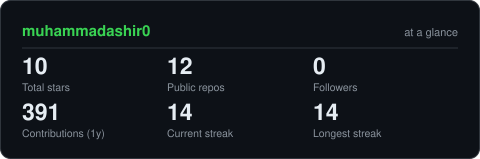
</picture>

<br>


<br><br>


<br><br>

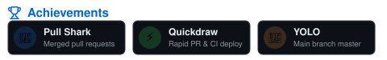

</div>

---

<div align="center">

## `~/` selected work

<!-- Cards generated by scripts/cards.py from assets/projects.json -->
<table>
<tr>
<td width="50%">
  <a href="https://github.com/muhammadashir0/mandatepay">
    <picture>
      <source media="(prefers-color-scheme: dark)"  srcset="assets/card-mandatepay-dark.svg">
      <source media="(prefers-color-scheme: light)" srcset="assets/card-mandatepay-light.svg">
      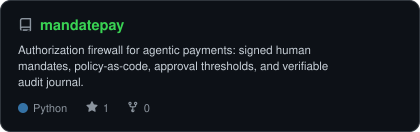
    </picture>
  </a>
</td>
<td width="50%">
  <a href="https://github.com/muhammadashir0/regledger-ai">
    <picture>
      <source media="(prefers-color-scheme: dark)"  srcset="assets/card-regledger-ai-dark.svg">
      <source media="(prefers-color-scheme: light)" srcset="assets/card-regledger-ai-light.svg">
      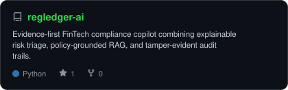
    </picture>
  </a>
</td>
</tr>
<tr>
<td width="50%">
  <a href="https://github.com/muhammadashir0/europulse-fraud-guard">
    <picture>
      <source media="(prefers-color-scheme: dark)"  srcset="assets/card-europulse-fraud-guard-dark.svg">
      <source media="(prefers-color-scheme: light)" srcset="assets/card-europulse-fraud-guard-light.svg">
      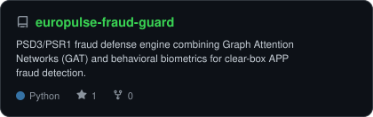
    </picture>
  </a>
</td>
<td width="50%">
  <a href="https://github.com/muhammadashir0/Portfolio">
    <picture>
      <source media="(prefers-color-scheme: dark)"  srcset="assets/card-Portfolio-dark.svg">
      <source media="(prefers-color-scheme: light)" srcset="assets/card-Portfolio-light.svg">
      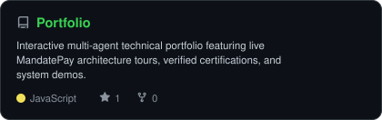
    </picture>
  </a>
</td>
</tr>
</table>

<sub>

| project | focus | stack | live / repo |
|---|---|---|---|
| **[MandatePay](https://github.com/muhammadashir0/mandatepay)** | Agent Payments Authorization Firewall & Control Plane | `Python` `MCP` `HMAC` `Policy-as-Code` | [★ Star Repo ↗](https://github.com/muhammadashir0/mandatepay) |
| **[RegLedger AI](https://github.com/muhammadashir0/regledger-ai)** | Evidence-First AML Compliance Copilot & Grounded Audit Chain | `Python` `RAG` `XAI` `Audit Chain` | [★ Star Repo ↗](https://github.com/muhammadashir0/regledger-ai) |
| **[Europulse Fraud Guard](https://github.com/muhammadashir0/europulse-fraud-guard)** | PSD3/PSR1 Graph Attention & Behavioral Biometrics Fraud Engine | `Python` `PyTorch` `GAT` `FastAPI` | [★ Star Repo ↗](https://github.com/muhammadashir0/europulse-fraud-guard) |
| **[Portfolio](https://github.com/muhammadashir0/Portfolio)** | Interactive Multi-Agent Portfolio & Live Architecture Tours | `React` `Vite` `JavaScript` `GitHub Pages` | [Live Demo ↗](https://muhammadashir0.github.io/Portfolio/) |

</sub>

<br>

<a href="https://github.com/muhammadashir0?tab=repositories"></a>

</div>


<div align="center">

## `~/` open channel

<!-- Animated direct collaboration scene - scripts/animated_scenes.py -->
<a href="https://github.com/muhammadashir0">
  
</a>

<br>

<a href="https://github.com/muhammadashir0"></a>
<a href="https://github.com/muhammadashir0/muhammadashir0"></a>

<br><br>

<sub>
**Want this animated character + SVG Proof Loop setup for your own GitHub?** Fork or ★ star **[`muhammadashir0/muhammadashir0`](https://github.com/muhammadashir0/muhammadashir0)** — built with pure CSS/SMIL SVG scenes (`scripts/animated_scenes.py`) & daily GitHub Actions.
<br>
[GitHub](https://github.com/muhammadashir0) · [Live Portfolio](https://muhammadashir0.github.io/Portfolio/) · [Data Portfolio](https://datascienceportfol.io/ashirali0998) · [LinkedIn](https://de.linkedin.com/in/muhammadashir1) · [Email](mailto:ashirali0998@gmail.com)
</sub>

</div>

---

<div align="center">

## `~/` field notes

<!-- Animated operating principles scene - scripts/animated_scenes.py -->

</div>

---

<div align="center">

<sub>`01110100 01101000 01100001 01101110 01101011 01110011 00100000 01100110 01101111 01110010 00100000 01110011 01100011 01110010 01101111 01101100 01101100 01101001 01101110 01100111`</sub>

</div>
